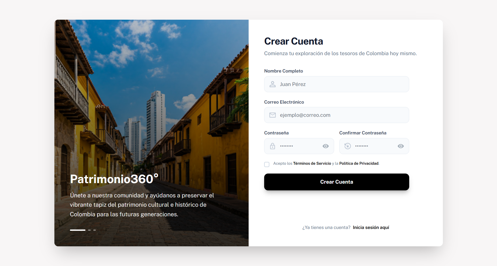
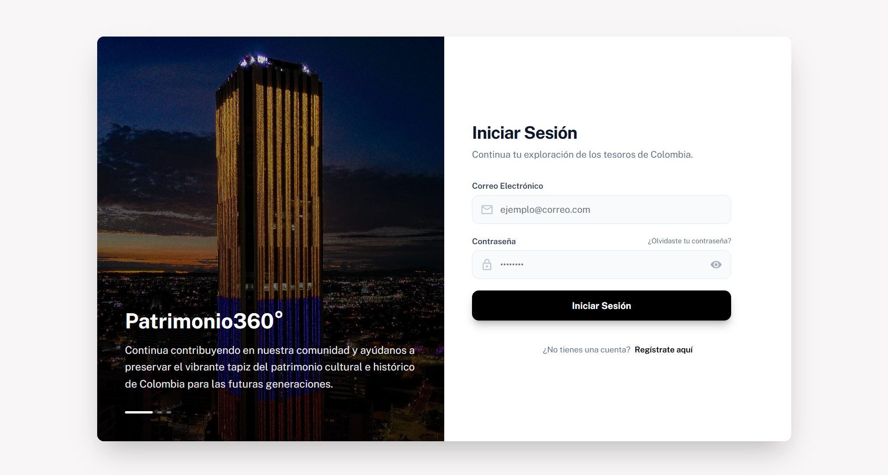
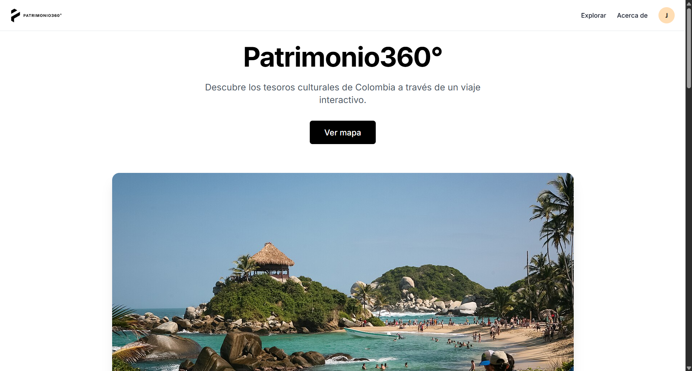
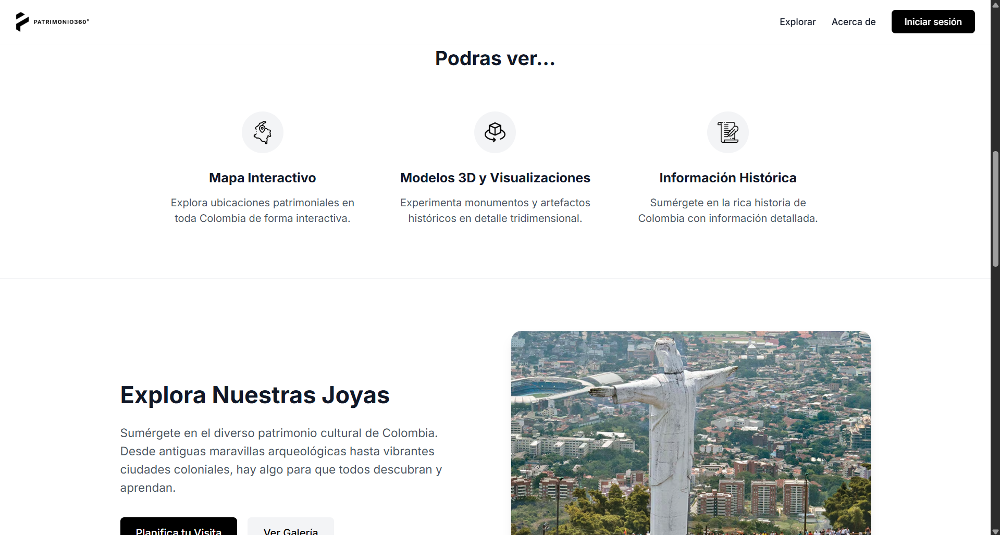
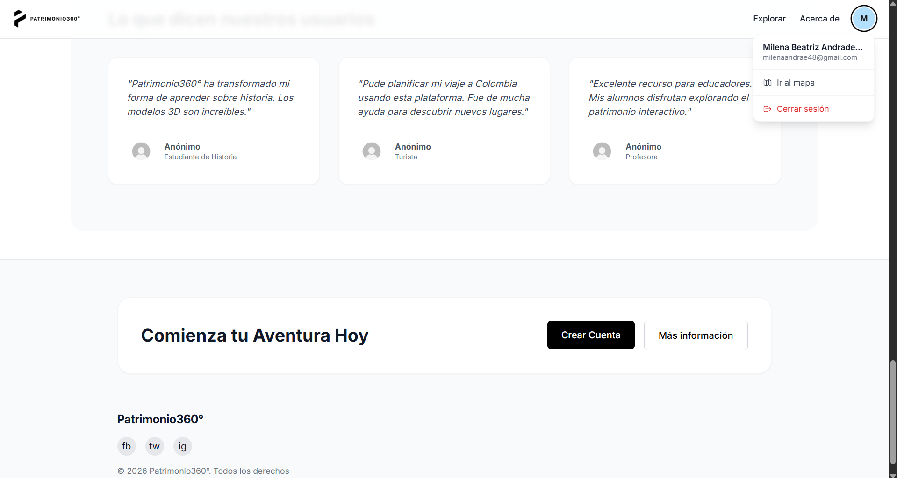
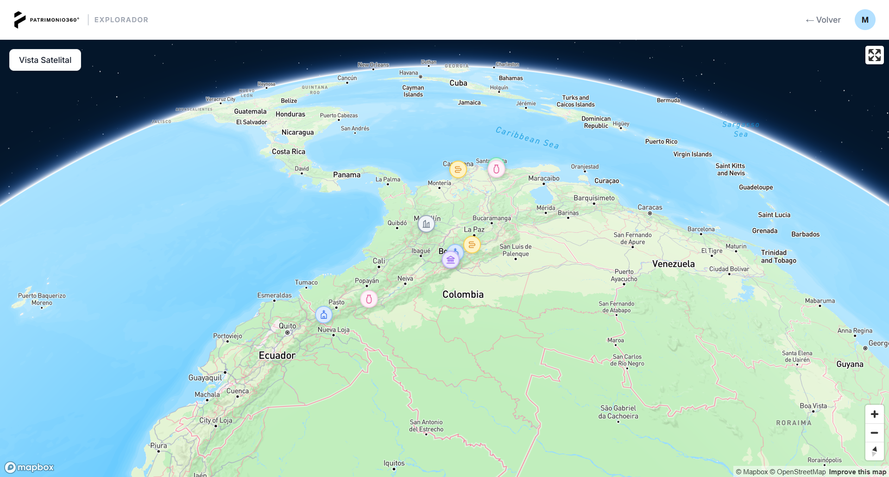
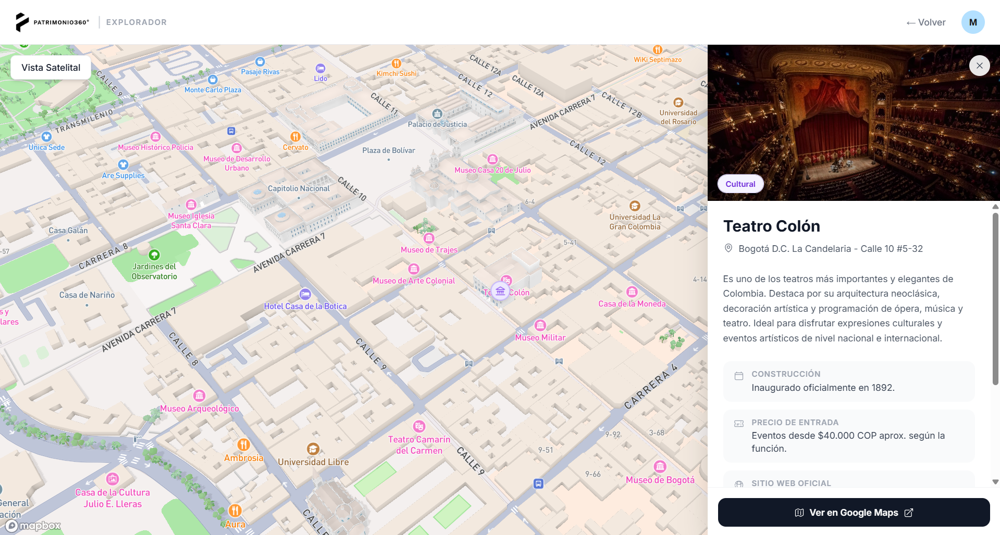
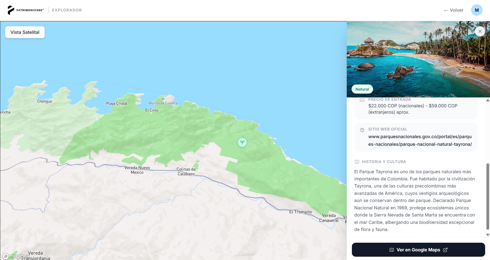
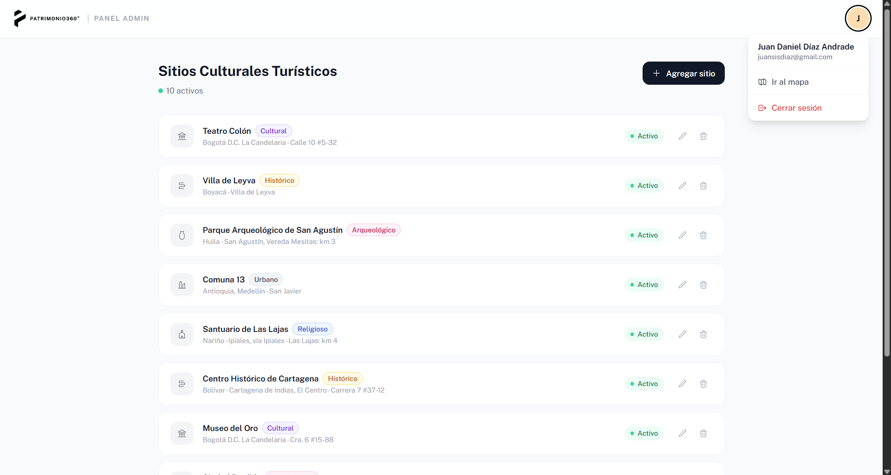
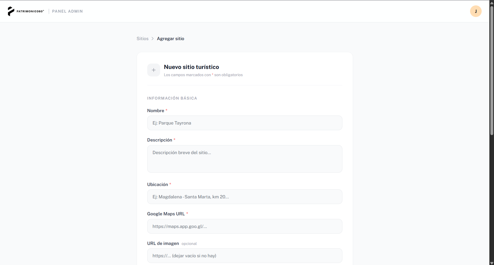

# Patrimonio360°

A Colombian cultural tourism web platform that allows users to explore heritage sites through an interactive map with historical information, categories, and cultural context for each location.

---

## Tech Stack

**Frontend**
- React + Vite
- Tailwind CSS
- React Router
- Mapbox GL JS
- Public Sans / Inter

**Backend**
- Node.js + Express
- MongoDB Atlas + Mongoose
- JWT (authentication)
- bcryptjs

---

## Project Structure

```
patrimonio360/
├── frontend/
│   ├── public/
│   │   └── images/
│   ├── src/
│   │   ├── components/      # Header, Footer, PrivateRoute, AdminRoute
│   │   ├── context/         # AuthContext
│   │   ├── hooks/           # useAnimations, usePageAnimations
│   │   └── pages/           # Home, Login, Register, Map, Admin
│   └── .env
├── backend/
│   ├── models/              # User.js, Location.js
│   ├── routes/              # auth.js, locations.js
│   ├── middleware/          # auth middleware
│   └── .env
```

---

## Live Demo & Screenshots

#### Register


#### Login


#### Home Page




#### Map




#### Admin Panel



---

## Installation & Setup

### 1. Clone the repository

```bash
git clone https://github.com/your-username/patrimonio360.git
cd patrimonio360
```

### 2. Set up environment variables

**`frontend/.env`**
```env
VITE_MAPBOX_TOKEN=""
```

**`backend/.env`**
```env
MONGODB_URI=""
PORT=3000
JWT_SECRET=""
JWT_EXPIRES_IN="7d"
```

### 3. Install dependencies

```bash
# Frontend
cd frontend
npm install

# Backend
cd ../backend
npm install
```

### 4. Run the project

In two separate terminals:

```bash
# Terminal 1 — Backend
cd backend
npm start

# Terminal 2 — Frontend
cd frontend
npm run dev
```

The app will be available at `http://localhost:5173` and the backend at `http://localhost:3000`.

---

## Routes

| Route | Description | Access |
|---|---|---|
| `/` | Home page | Public |
| `/login` | Sign in | Public |
| `/register` | Create account | Public |
| `/map` | Interactive map | Authenticated |
| `/admin` | Admin dashboard | Admin only |

---

## Data Models

**User (`User`)**

| Field | Type | Description |
|---|---|---|
| `name` | String | Full name |
| `email` | String | Email address (unique) |
| `password` | String | Password hashed with bcryptjs |
| `role` | String | `'user'` or `'admin'` |

**Tourist Site (`Location`)**

| Field | Type | Description |
|---|---|---|
| `name` | String | Site name |
| `description` | String | Short description |
| `category` | String | `natural`, `cultural`, `histórico`, `arqueológico`, `religioso`, `urbano` |
| `image` | String | Image URL |
| `location` | String | Human-readable location |
| `coordinates` | Object | `{ lat, lng }` for the map |
| `googleMapsUrl` | String | Google Maps link |
| `historicalContext` | String | Historical and cultural context |
| `yearBuilt` | String | Year or period of construction |
| `entryPrice` | String | Entry price |
| `website` | String | Official website |
| `active` | Boolean | Visible on the map when `true` |

---

## API Reference

**Authentication**

| Method | Endpoint | Description |
|---|---|---|
| `POST` | `/api/auth/register` | Register a new user |
| `POST` | `/api/auth/login` | Sign in |

**Tourist Sites**

| Method | Endpoint | Access | Description |
|---|---|---|---|
| `GET` | `/api/locations` | Authenticated | Get active sites |
| `GET` | `/api/locations/all` | Admin | Get all sites |
| `POST` | `/api/locations` | Admin | Create a site |
| `PUT` | `/api/locations/:id` | Admin | Update a site |
| `DELETE` | `/api/locations/:id` | Admin | Delete a site |

---

## Author

**Juan Daniel Díaz Andrade**  
University project — 2025
